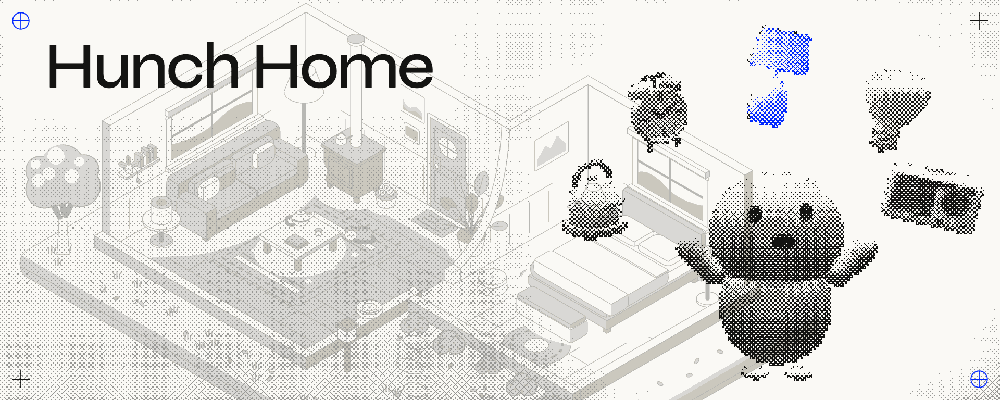
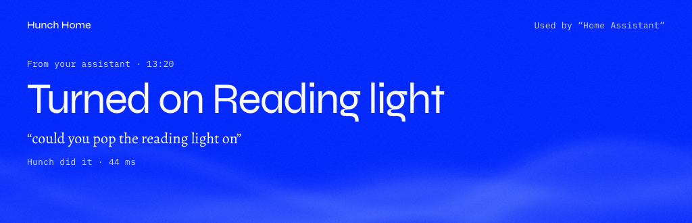
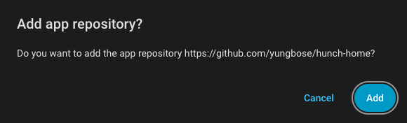
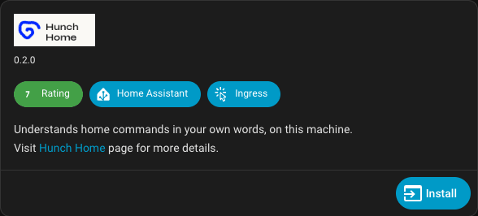
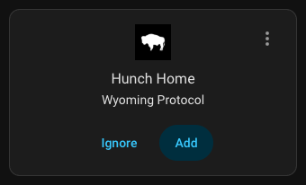
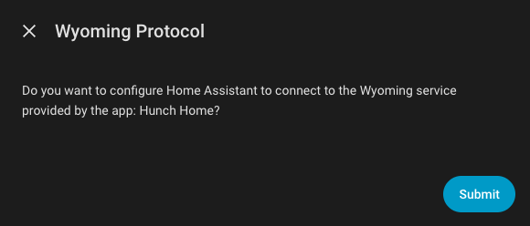
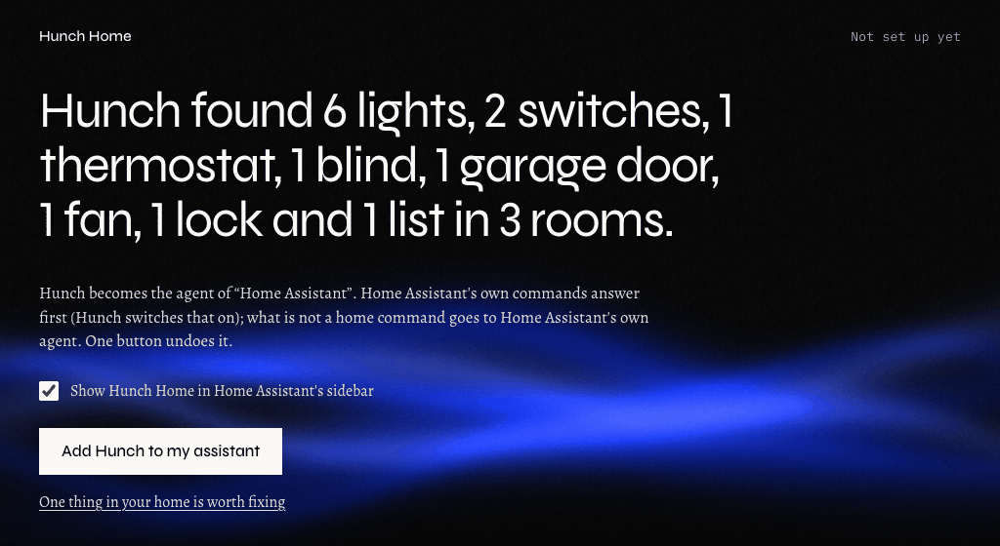
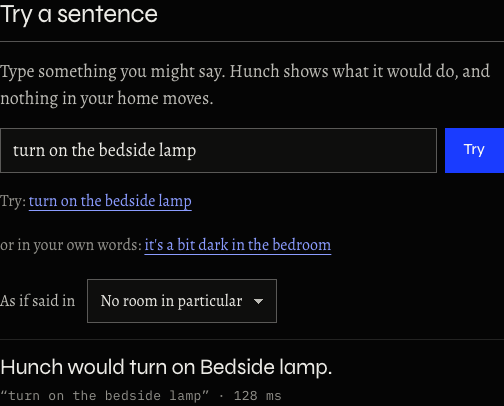

# Hunch Home

A small local model for Home Assistant that understands home commands in your own words. No LLM, no GPU, no
cloud.

Say "turn the lights on" and the lights come on, in tens of milliseconds, on a Raspberry Pi.

**Why**

- Home Assistant's own commands need the right phrasing.
- A local LLM needs a GPU and takes seconds to answer.
- A cloud LLM takes time too, and sends your data somewhere else.

Hunch does one job: work out what a home command means. It is small enough for the machine you already run Home
Assistant on.

**What it does**

- Works across the home, not only lights: heating, blinds, locks, speakers and TVs, timers, scenes, to-do lists,
  plugs, fans and the vacuum ([the full list](#what-it-can-do)).
- Understands commands however you say them: "turn on the reading light", "could you pop the reading light on",
  "kill the reading light".
- Runs on your machine in about 550 MB of memory. No account, no key. Nothing leaves your home.
- Sits in front of the assistant you already have. Home commands are Hunch's. Questions and everything else go to
  your own agent, including a language model if you use one.
- Learns your wording. It won't get everything right, and you can teach it with your own examples.
- Unlocks or opens only a lock or door you name, and one switch keeps it away from them
  ([Locks and doors](#locks-and-doors)).

**What it doesn't do (yet)**

- Answer questions or chat. Your other agent does that.
- Just works in English for now.
- Scheduling ("in ten minutes"), or two commands in one sentence.

**Experimental:** listening with no wake word, using a USB microphone. It all runs on your machine, so nothing it
hears goes anywhere. Off unless you switch it on.

## What you need

- Home Assistant 2026.11 or later, with an English assistant (English only).
- Home Assistant OS (or Supervised). On Home Assistant Container, run the image
  `ghcr.io/yungbose/hunch-home:0.2.0` as [DOCKER.md](DOCKER.md) says.
- A 64-bit machine: a Raspberry Pi 4 or 5 with a 64-bit system, or a PC.
- About 550 MB of free memory, and about 1.5 GB in all if you switch on listening with no wake word.
- A download of about 700 MB. The first start takes a few minutes on a Raspberry Pi.

## Install

1. [Add this repository to your Home Assistant](https://my.home-assistant.io/redirect/supervisor_add_addon_repository/?repository_url=https%3A%2F%2Fgithub.com%2Fyungbose%2Fhunch-home) (or by hand: **Settings > Apps > Install app**, the three-dot menu, **Repositories**, **Add**, and paste `https://github.com/yungbose/hunch-home`).

   

2. Install **Hunch Home** and start it. (Its **Log** tab says `model 1.1 loaded` when it is ready.)

   

3. Open **Settings > Devices & services**. Under **Discovered** you will see **Hunch Home**: press **Add**, then **Submit**.

    

4. Open the app's page (**Open web UI** on the app's **Info** tab) and press **Add Hunch to my assistant**.

   

The page then shows what Hunch found in your home, and anything worth fixing. The button makes Hunch your
assistant's agent and remembers the one it had.

## Try it

Under **Try a sentence** on the app's page are two examples made from your own light and room: a plain one, and
one in people's own words. Press each to see what Hunch would do (nothing moves). Then say or type one to your
assistant, and look at **What happened** on the page.

Said to a voice device in a room, or heard by listening, "turn the lights on" acts in that room. Typed, a command
must name a device or a room, since Hunch cannot know which room you are in. A plain command such as "turn on the reading light" may be answered by Home Assistant itself first
and then will not appear on Hunch's page, which is expected.

The rule: a home command is Hunch's, which does it or says in one short line why not; everything else goes to
your other agent.

| The page says | What it means |
|---|---|
| Hunch did it | Hunch carried it out. The page leads with what was done, such as "Turned on Reading light". |
| Hunch did nothing | A home command it could not carry out. The page leads with a short reason, such as "Couldn't work out which device you meant". |
| Passed to Home Assistant (or your other agent) | Not a home command: your other agent answered. |
| Could not reach ... | Your other agent did not answer. |
| Ignored | Listening heard something that was not a command, and kept nothing. |

## What it can do

| Kind | What the app does |
|---|---|
| Lights | On, off, a brightness, a colour, brighter and dimmer. |
| Climate | Thermostats on and off, a temperature; blinds, curtains and shutters open and closed. |
| Security | Locking locks; with Locks and doors on, unlocking, opening and closing a named lock, door, gate or garage door. |
| Speakers & TVs | On, off, play something named, pause, resume, mute, volume, next, previous. |
| Timers and alarms | Start, cancel, check and change a simple timer, on a voice device that has timers. |
| Scenes | Activate a named scene. |
| Weather | The current weather. |
| Lists | Add an item to, or remove one from, a named to-do list. |
| Other device | A named switch, fan or input boolean on and off; a vacuum started and sent home. |
| Water | Nothing yet; it is passed on. |

Limits:

- One command per sentence. Two in one sentence are passed on.
- Nothing at a later time: "unlock the door in ten minutes" is not done. Timers are the exception.
- A number or time it cannot be sure of ("1,000 percent") is not acted on.
- A device is found by its name or another name it has in Home Assistant, whole: "the lamp" does not reach
  "Lamp B" until it has "Lamp" as another name (**Settings > Voice assistants > Expose**, **Add alias**). A lamp
  on a smart plug: in the plug's settings choose **Show as: Light** and give it a room, and "turn on the
  kitchen lights" reaches it.
- Thin spots: "turn on the cooling" switches the thermostat on in its last mode, not necessarily cooling, and a
  kettle or stopping a vacuum is often not understood. Teaching it (below) fixes that for your home.

## How accurate it is

On 474 real typed home commands in people's own words, held out from teaching, the model inside the app
(Hunch-1.1 Home) got both the action and the kind right for 70.9%, up from 38.0% for the previous version. Try it
on lamps before locks.

| Result | Share of the 474 |
|---|---|
| Right | 70.9% |
| Wrong | 12.2% |
| Declined (passed on to your other agent) | 16.9% |

The right answers were set by two language models that agreed, not checked by a person. By kind, and the rest:
[the model's page](https://huggingface.co/xevall/hunch-1-home).

## Teaching it your words

When Hunch gets a sentence wrong, press **That was wrong** under it on the page, choose what it should have
understood, and press **Teach Hunch**. From then on it answers that sentence, and others worded like it, your way.
What you taught stays on this machine and can be removed under **What you have taught**. Teaching never changes
the rules: a taught sentence still cannot unlock a lock it does not name.

## Locks and doors

With **Locks and doors** on (the default), Hunch unlocks, opens or closes only a lock, door, gate or garage door
the sentence names; with none named, only the room's window coverings move. Do not give a lock or door the same
name as its room. A wrong answer can still move the one you named (security commands were 57.7% right), so expose
only the locks and doors you want spoken to, and try your own first.

Home Assistant's own sentences answer many everyday wordings before Hunch is asked, including "unlock the front
door", so the Locks and doors switch does not govern those. To keep a lock or door from voice altogether, stop
exposing it to Assist.

With the switch off, Hunch unlocks no lock and opens or closes no door, gate or garage door, and says so; it still
locks locks and moves window coverings.

## Listening with no wake word (experimental)

Off unless you switch it on. With a USB microphone on your Home Assistant machine, Hunch acts on the commands
it hears. It never unlocks a lock, never opens or closes anything but window coverings, passes nothing on, and keeps nothing it ignored. It asks before fetching its speech model (about
482 MB). How often it acts by mistake in a real room is not measured. In one informal test with voices played
from a speaker, it carried out about half the spoken commands, each on the right lamp, and one sentence of
ordinary talk about a lamp switched the lamp. [How to switch it on](REFERENCE.md#switching-on-listening).

## Your data

Nothing leaves your machine by Hunch's own doing, unless you switch on the daily counts.

- **The record** of each sentence stays on this machine: the latest 1,000, none older than 30 days. Switch it
  off, or clear it, under **Settings** on the page.
- **Passed-on sentences** go to the agent you chose; a cloud language model gets them under its own terms.
- **Your voice.** Hunch gets words, not sound, from Assist. Listening turns sound into words on this machine.
- **The daily counts** (off unless you switch them on) send counts to xevall once a day, never a sentence or a
  device or room name. Switching them off deletes what this home sent.
- **Fetching.** Only the speech model, once, if you switch on listening.

The privacy notice, [PRIVACY.md](PRIVACY.md), says what is sent, who keeps it, for how long, and how to have it
deleted.

## Removing it

Before you uninstall Hunch Home, press **Stop using Hunch** on the app's page for each assistant that uses it.
The app cannot tidy up after itself once it is removed.

1. On the app's page, under **Assistants**, press **Stop using Hunch** for each assistant that uses Hunch.
2. If you shared daily counts, switch **Share daily counts** off and leave the app running for a minute, so it can
   ask for this home's counts to be deleted.
3. Uninstall the app. Home Assistant removes Hunch's agent by itself, and deletes the app's own folder with
   everything in it: the record, what you taught it, its settings, its install number and the speech model. A
   reinstall starts afresh.

If you uninstalled it first, your assistant still points at Hunch, which is no longer there, and Assist answers
every sentence with an error ("Oops, an error has occurred"), even Home Assistant's own commands. To fix it:
**Settings > Voice assistants**, choose the assistant and set its **Conversation agent** back to the one you had
before (such as Home Assistant). Hunch also switched on **Prefer handling commands locally**; switch it off again
if it was off before.

## Help and bugs

Open an issue at [github.com/yungbose/hunch-home/issues](https://github.com/yungbose/hunch-home/issues). The
app's **Log** tab is safe to paste: it holds no sentences and no device names.

## Licence

Code: Apache 2.0 ([LICENSE](LICENSE)). The model inside, Hunch-1.1 Home: CC BY-NC 4.0, free for home, research
and other non-commercial use, with credit; commercial use needs permission (licensing@xevall.com). [NOTICE](NOTICE) says what is whose; the image carries every licence under `/licenses`.
Listening uses Parakeet TDT 0.6B v2 by NVIDIA (CC BY 4.0), as sherpa-onnx publishes it, with the sherpa-onnx
library (Apache 2.0) and the Silero speech detector (MIT); credits under `/licenses/listening/NOTICE`.

Made by [xevall](https://xevall.com). The settings, permissions and what has been tried: [REFERENCE.md](REFERENCE.md).
