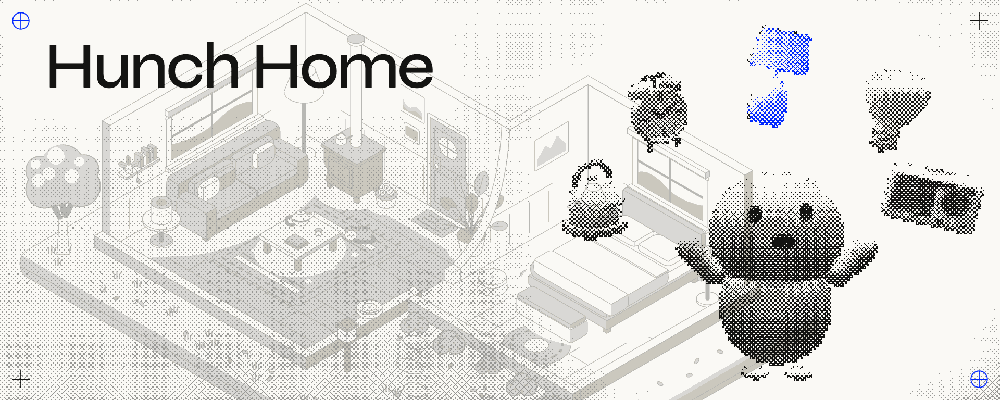

# Hunch Home

Hunch carries out home commands, such as "turn on the reading light", and the same command in your own words,
such as "it's a bit dark in the living room", on this machine. It joins your assistant as its conversation agent:
Home Assistant's own sentences still answer first, a home command is Hunch's (it does it, or says in one short
line why not), and anything else goes to the agent your assistant had before.

## After you install it

1. Start the app. It is ready when its **Log** tab says `model 1.1 loaded`.
2. Open **Settings**, then **Devices & services**. Under **Discovered** you will see **Hunch Home**: press
   **Add**, then **Submit**.
3. Open the app's page (**Open web UI** on this tab) and press **Add Hunch to my assistant**. Leave the box
   ticked to put Hunch Home in the sidebar.

Now type or say a command to Assist in your own words.

While the app restarts, Assist may say "Error communicating with service" for a second or two. And for about
half a minute after Home Assistant itself restarts, Assist answers nothing: that is Home Assistant starting, and
Hunch answers again once it has.

## Removing it

Before you uninstall Hunch Home, press **Stop using Hunch** on the app's page for each assistant that uses it,
or Assist will stop answering. The app cannot tidy up after itself when it is removed.

1. On the app's page, under **Assistants**, press **Stop using Hunch** for each assistant that uses Hunch.
2. If you shared daily counts, switch **Share daily counts** off and leave the app running for a minute, so it can
   ask for this home's counts to be deleted. **Your data** on the page says when that has gone through.
3. Uninstall the app here. Home Assistant removes Hunch's agent and its entry under Wyoming by itself, and
   deletes the app's own folder: the record, what you taught it, its settings, its install number and the
   speech model. A reinstall starts afresh.

If you uninstalled it first, your assistant still points at Hunch, which is no longer there, and Assist answers
every sentence with an error ("Oops, an error has occurred"), even Home Assistant's own commands. To fix it, open
**Settings**, **Voice assistants**, choose the assistant and set its **Conversation agent** back to the one you
had before (such as Home Assistant). Hunch also turned on **Prefer handling commands locally**; turn it off again
if it was off before.

## The page

In the sidebar, or through **Open web UI**: what Hunch found, a box to try a sentence (with two examples from
your own home), each sentence with what Hunch did, and the settings. Only people signed in to Home Assistant can open it.

## Locks and doors

Hunch moves a lock, door, gate or garage door only when your sentence names it, and a switch on the page turns
that off. Home Assistant's own sentences answer many everyday wordings before Hunch is asked, including "unlock
the front door", so the Locks and doors switch does not govern those. To keep a lock out of voice control
altogether, stop exposing it to Assist.

## Listening with no wake word (experimental)

Off unless you switch it on, with a USB microphone chosen under **Audio** on the **Configuration** tab. It
never unlocks or opens anything but window coverings, passes nothing on, and keeps nothing it ignored.

- It downloads its speech model once (about 482 MB), only after you press **Fetch it and switch on**.
- It reads only the microphone's description from the Supervisor's API, to name it on the page.
- It needs about 0.9 GB more memory, and keeps trying a microphone that stops answering.

## Limits

English only; 64-bit only; about 550 MB of memory, 1.5 GB with listening. The app has an administrator's
access, which Home Assistant gives every app that uses its API, and changes only the two settings the button sets.

## More

The rest: the read-me (https://github.com/yungbose/hunch-home/blob/main/README.md), the reference
(https://github.com/yungbose/hunch-home/blob/main/REFERENCE.md) and the privacy notice
(https://github.com/yungbose/hunch-home/blob/main/PRIVACY.md).

Code Apache 2.0; model CC BY-NC 4.0 (commercial use needs permission from xevall). Listening uses Parakeet TDT
0.6B v2 by NVIDIA (CC BY 4.0, https://huggingface.co/nvidia/parakeet-tdt-0.6b-v2), sherpa-onnx (Apache 2.0) and Silero (MIT). Licences: `/licenses` in the image.
